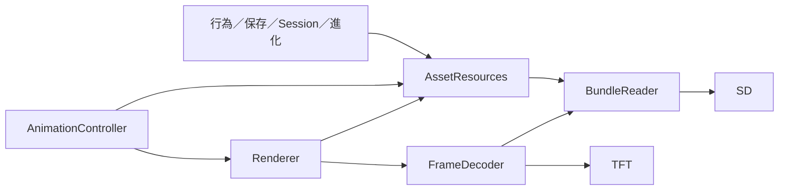

# Renderer 資源拆分設計與驗證（2026-10-31）

## 設計決定

現況：Renderer::AnimationState 同時擁有 BundleReader、1,024 B read buffer、資源錯誤、播放影格與 3,072 B line buffer。PetSession／PetSaveController／PetBehaviorRuntime／AppearanceChangeController／EvolutionController 為了 SD 或錯誤狀態依賴 Renderer，Game 甚至經 AnimationController::sdCard 轉取 SD。

比較兩個設計：

| 設計 | 所有權與呼叫方式 | 判斷 |
| --- | --- | --- |
| A：具體 AssetResources 擁有 reader／read buffer／metadata／錯誤 | 平台建立並注入 Renderer 與需要資源的邏輯；Renderer 只在實際繪圖時借用既有 buffer／reader | 採用。移動實際資料與實作，非繪圖呼叫者不必知道 Renderer |
| B：只抽 metadata／錯誤 facade，reader／buffer 留在 Renderer | 新類別仍須回呼 Renderer，或各自建立 reader／cache | 不採用。責任仍依賴顯示器，或增加 buffer、查詢及同步成本 |

不新增虛擬資源階層、service locator、callback registry 或相容轉接層。BundleReader 繼續處理 pack／record 實際讀取及既有 cache；AssetResources 集中其生命週期、metadata 查詢與跨來源錯誤。FrameDecoder 保留 codec／串流像素輸出。

## 使用與介面草圖

```cpp
AssetResources resources(&SD);
Renderer renderer(&tft, resources);
Game game(pet, storage, renderer, resources, appearanceLoader);

// 原本需要 Renderer 才能取得 SD／metadata 的規則與生命週期：
PetSession(..., resources, ...);
PetBehaviorRuntime(..., animations, resources);

class AssetResources {
public:
    explicit AssetResources(SdFat*);
    bool configureBundle(const BundleId&);
    bool resolveAnimation(const AnimationRef&, uint8_t version, AnimationRecord&);
    uint16_t frameCountFor(...);
    uint16_t versionCountFor(...);
    unsigned long frameIntervalFor(...);
    void recordAssetDataErrorResource(const char*);
    BundleError firstAssetDataError() const;
    const char* firstAssetDataErrorResource() const;
    SdFat* sdCard() const;
    // 僅同步 FrameDecoder 呼叫借用；不可跨呼叫或重入持有 buffer。
    BundleReader& frameReader();
    uint8_t* readBuffer();
};
```

Renderer 移除 SD／configureBundle／metadata／error recording 舊介面；AnimationController 移除 sdCard 轉接。繪圖與資源都需要的模組明確注入兩者。PetSaveController 的 debug 訊息直接依賴 DebugDisplay，只有 debug 編譯才持有該依賴。

AssetResources 採固定大小成員，由平台／測試直接建立；Renderer 原有 heap 只留下播放／繪圖 state 與 line buffer。不新增第二份 read buffer，也不增加一次 heap 配置。靜態 RAM 上升與 Renderer heap 下降必須一起呈現，不能將移動儲存位置當作節省。

## 保留條件與驗證計畫

- 先保存拆分前來源與相同三配置容量基線，再遷移全部 production callers 並刪除舊介面。
- 不改 read／line／audio buffer 大小、12 行 batch、BundleReader cache、prepare → layout → draw 或 SD 讀取時機。
- 保留資源錯誤的 first-error／pack 優先規則、debug 細節、保存與恢復語意。
- 重用既有 Game、實際像素、Animation Scene、資源錯誤、最大抽籤及圖鑑測試；新增獨立資源 owner 的有意義整合斷言。
- 重跑 Flash／靜態 RAM、ARM 物件及 Renderer heap 大小；真實裝置 FPS／峰值 stack／heap 仍另行驗收。

## 已完成的拆分

AssetResources 現在實際擁有 Renderer 原有的長期 BundleReader／cache、1,024 B read buffer、SD 參照及外部資源錯誤。metadata 查詢實作已搬移；Renderer 舊方法與 AnimationController::sdCard 已刪除，沒有留相容轉接層。原本 RuntimeContractLoader 的短期 reader／scratch 不在本輪合併。

PetBehaviorRuntime、PetSession、PetSaveController、AppearanceChangeController、EvolutionController 與 BaseAnimationRotation 已不再依賴 Renderer。AnimationController、LayoutRenderer、外觀選單、圖鑑及 Instruction 顯示明確取得繪圖與資源兩個依賴。Game 保留協調政策；平台明確建立單一 AssetResources，生命週期長於其使用者。



Renderer 保留動畫區域、目前影格、line buffer、TFT 與錯誤畫面的呈現。資源錯誤的保存、first-error 與 pack 優先選擇集中於 AssetResources；DebugDisplay 只用於保存紀錄的 debug 呈現。

移除資源欄位後，line buffer 的自然排列會改變，因此顯式加上 `alignas(uint64_t)`。ARM 探針確認原 line buffer offset 1,144 B、最終 offset 24 B，皆為 8 的倍數；最終 state 對齊為 8 B。最終容量表使用此版本，沒有採用較弱對齊的中途結果。

## 實際連結與記憶體比較

工具：`test/lottery_capacity/measure_refactor.ps1`；沿用 genericSTM32F103C8、`-Os -flto`、相同函式庫與各配置功能旗標。Flash 是載入 sections，成功配置皆比對 firmware.bin 長度。固定 owned heap 由 `probe_owned_heap.ps1` 在 Cortex-M3 ABI 下，依相同 profile defines 編譯實際類別／Renderer state 後，以 nm 取得大小。

| 配置 | Flash 前→後 | 靜態 RAM 前→後 | 固定 owned heap 前→後 | 已知常駐小計前→後 |
| --- | ---: | ---: | ---: | ---: |
| maximum：8 Actions／224 Outcomes | 59,832→59,824 B | 9,960→11,096 B | 4,652→3,540 B | 14,612→14,636 B（+24） |
| numeric：200 rules＋Guess | 62,184→62,172 B | 13,136→14,264 B | 4,700→3,588 B | 17,836→17,852 B（+16） |
| allfeatures：8 Actions／224 Outcomes | 74,640→74,528 B | 14,964→16,092 B | 5,012→3,912 B | 19,976→20,004 B（+28） |
| independent：16 Actions／248 Outcomes | 59,848→59,836 B | 10,584→11,720 B | 4,652→3,540 B | 15,236→15,260 B（+24） |

前三配置與前輪完全相同；independent 使用相同基本功能旗標與一筆 rule，另明確設定 16 Actions／248 Outcomes，未開全部選配功能。早期以 `-U/-D` 組合建立 independent 的試跑因 PlatformIO 重排旗標而無效，已排除；表內使用獨立完整 build_flags 的重測結果。

Renderer heap 由 4,216→3,096 B，新增 AssetResources 常駐物件 1,128 B。read buffer 1,024 B、line buffer 3,072 B（合計 4,096 B）、12 行 batch 及 audio buffer 均未縮減。新增物件沒有引入一次 heap 配置；已有固定 Controller 的參照與對齊造成少量淨增加。

已知常駐小計是 `.data + .bss` 加 Renderer state 及 Game 持有的固定 unique_ptr 物件大小，**未含 allocator 管理／向上對齊、其他庫的 heap、stack、ISR**，不是實機峰值。allfeatures 小計 20,004 B，相對 20 KiB 僅餘 476 B 供上述未計項目，不能當作可用 RAM 驗收。allfeatures Flash 仍超出 64 KiB **8,992 B**，沒有成功可燒錄 image；其他三配置成功連結。

本輪省 Flash 8／12／112／12 B，沒有 RAM 節省。收益是資源的生命週期、錯誤與查詢不再依賴顯示器。

## I/O 與播放驗證

在相同生產讀取／繪圖實作與 fixtures 上，對拆分前保存的來源及最終來源套用相同 host File 計數。原本 pixel／layout 工作區段結束後才做新增的獨立 metadata 測試；每個案例重設計數，避免把新增驗收查詢混入繪圖流程比較。

| 真實匯出版面流程 | 案例數 | open 次數（前後相同） | read 次數（前後相同） | read bytes（前後相同） |
| --- | ---: | ---: | ---: | ---: |
| custom layout 全部像素／選擇／恢復 | 7 | 1,070 | 17,988 | 4,225,074 |
| numeric200 邊界／同圖不重畫／恢復 | 1 | 1,110 | 9,526 | 3,045,217 |

每個繪圖像素仍與 Web 匯出的預期資料比對；各案例 open／read／bytes 計數相同。另驗證 metadata 可在沒有 Renderer 時使用，外部資源錯誤在 Renderer 建立前及銷毀後仍由資源 owner 保留。

這證明受測 host 流程沒有新增 SD API 查詢；不是裝置 FPS、SPI throughput 或輸入延遲量測。prepare → layout → draw、首幀後才啟動 audio、既有 cache 與時間排程不變。

## 驗證結果與證據

- Web preflight 通過；canonical `verify.ps1 -TestGroup behavior,evolution,screen-layout,export -BackendOnly -Completion`：**156 tests＋backend architecture 通過**，不是全 Web suite。
- Game 一般流程與指定多功能組合通過：FirstStart、保存／reset、外觀、圖鑑、Guess／Predict、audio、Death、Evolution 與前景切換。
- Instruction-only 及上述多功能組合的 Instruction 通過：延後效果、reset、Battery 取消、慢畫面不縮短回答／feedback、保存失敗不重播。
- idle audio 的 RTC／Action／STOP／Death／外觀中斷通過；真實 Web animation music 匯出通過 per-repeat／following audio、短 EOF、bounded retry 與取消。舊 audio fixture 版本不符，最終使用公開 API 重新匯出的隔離 fixture。
- PetBehavior Runtime：6／10／12 Stats、224 Outcomes、效果原子讀取失敗與 catalog gating 通過。
- 最大真實 Lottery：8 Outfit／224 fixed-Version Outcomes／2,688 effects 全部映射通過；獨立額度真實匯出：8 普通＋8 Lottery、248 Outcomes、button slot15 通過。
- 真實圖鑑 Guess 的 round／final 兩次保存與中斷恢復、Species／Outfit activation、同目標與授予語意通過。
- Animation Scene 首幀／queue／completion／interruption 通過；debug startup error 與獨立資源錯誤 owner 通過。另以 ENABLE_DEBUG=1 編譯 Game／Startup／PetSaveController 語法及依賴，並非 debug target 連結驗收。
- whitespace 與舊 Renderer 資源介面殘留檢查通過；host runner 的 constructor／metadata mocks 已遷移，原有功能斷言保留。

主要證據：`.pio/renderer-split/before/` 保存拆分前 production；`.pio/renderer-split/*log` 及 `io-comparison.json` 保存 host 記錄；`.pio/memory-refactor/renderer-{before,after}/` 與 `renderer-{before,after}-independent/` 保存 map、成功 ELF、sizes、型別及逐 profile owned-heap JSON。before-independent 原始輸出位於 before snapshot 的 `.pio/memory-refactor/renderer-before-independent/`，另複製至主要 evidence 目錄。

Web 記錄：`E:/C++/virtualPet/web/.verification/renderer-resource-split-backend.log`。本輪不修改 Web 生產／測試來源；生成 fixtures 屬 canonical verification 的產物。未 commit、push 或 flash。實機 FPS／峰值 RAM 及剩餘 Flash 缺口仍待處理。
